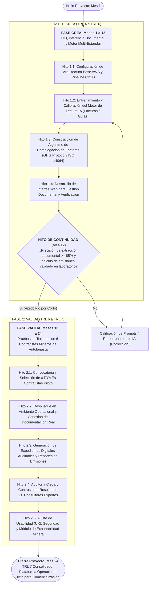
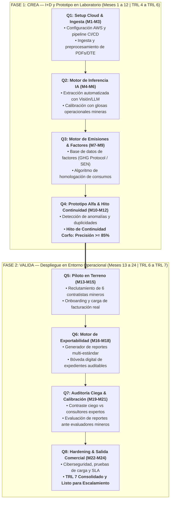
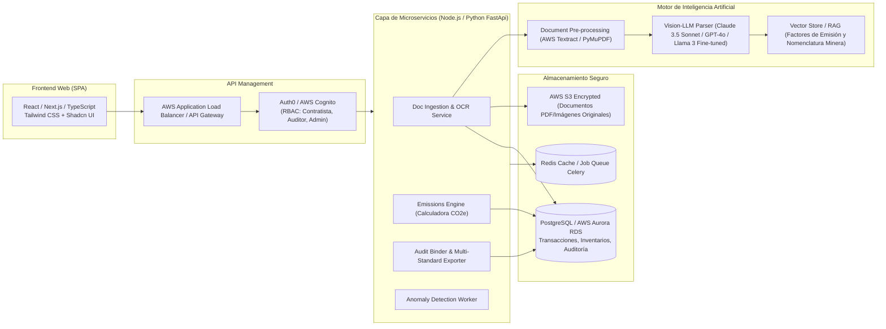

# Dossier Técnico y Arquitectura: SaaS de Huella de Carbono para Minería

> **Bienvenido a la revisión técnica del proyecto.**  
> En este documento encontrarás la arquitectura de sistemas, las especificaciones funcionales y la hoja de ruta tecnológica de la solución que postulamos al **Crea y Valida 2026 de Corfo Antofagasta**.  
> El objetivo es compartir contigo cómo abordamos la transición desde el prototipo validado en laboratorio (**TRL 4**) hacia una plataforma SaaS robusta, multi-estándar y validada en entorno operacional con 6 contratistas mineros (**TRL 7**).

**Destinatario:** Asesor Tecnológico / Revisión de Arquitectura de Sistemas  
**Titular del Proyecto:** Grupo Verdical SpA (Empresa B - Antofagasta)  
**Marco de Financiamiento:** Crea y Valida 2026 (Comité de Desarrollo Productivo Regional de Antofagasta / Corfo)  
**Trayectoria Tecnológica:** TRL 4 (Laboratorio validado) $
ightarrow$ TRL 7 (Operacional con 6 contratistas)  
**Horizonte:** 24 Meses (con Hito Crítico de Continuidad en Mes 12)

---

## 1. Diagrama del Modelo de Negocios (Business Model Canvas Sistémico)

El modelo de negocios opera como un **B2B SaaS (Software-as-a-Service)** especializado para pequeñas y medianas empresas contratistas de la minería en Antofagasta, eliminando la barrera de entrada técnica y financiera de consultorías tradicionales mediante automatización documental y certificación de evidencias para las mineras mandantes.

```mermaid
flowchart TB
    subgraph ECOSISTEMA["Ecosistema Operacional y Comercial"]
        subgraph SOCIOS["Socios Clave"]
            S1["Asociaciones Mineras Regionales<br/>(AIA, Clúster Minero)"]
            S2["Empresas Mineras Mandantes<br/>(BHP, Antofagasta Mins, Codelco)"]
            S3["Compañías Certificadoras / Auditores<br/>(ISO 14064 / GHG Protocol)"]
            S4["Proveedores Cloud & Modelos IA<br/>(AWS, OpenAI / Anthropic)"]
        end

        subgraph ACTIVIDADES["Actividades Clave"]
            A1["Ingeniería de Software & Arquitectura Cloud"]
            A2["Entrenamiento y Fine-tuning de Modelos de Lectura (OCR + LLM)"]
            A3["Actualización de Factores de Emisión Oficiales"]
            A4["Mapeo Semántico Multi-Estándar"]
            A5["Soporte Técnico y Acompañamiento a Contratistas"]
        end

        subgraph PROPUESTA["Propuesta de Valor"]
            PV1["<b>Automatización Radical:</b><br/>De la factura de combustible/energía al indicador de emisión en minutos sin digitación manual."]
            PV2["<b>Expediente Probatorio Auditable:</b><br/>Trazabilidad matemática 1:1 entre documento de compra y huella declarada."]
            PV3["<b>Exportabilidad Multi-Estándar:</b><br/>Un solo ingreso de datos genera reportes para GHG Protocol, ISO 14064, NIIF S2 y portales mineros."]
            PV4["<b>Accesibilidad Económica:</b><br/>Costo adaptado al presupuesto PYME contratista."]
        end

        subgraph RELACION["Relación con el Cliente"]
            RC1["Autoservicio Digital (Self-service SaaS)"]
            RC2["Onboarding y Soporte Especializado en Faena"]
            RC3["Capacitaciones Grupales (Franquicia SENCE Verdical)"]
        end

        subgraph SEGMENTOS["Segmentos de Clientes"]
            SC1["<b>Cliente Primario (B2B):</b><br/>PYMEs Contratistas de Servicios Mineros (Transporte, Perforación, Obras Menores, Alimentación, Mantención)."]
            SC2["<b>Beneficiario Indirecto (Stakeholder):</b><br/>Compañías Mineras Mandantes (Recepción de datos Scope 3 verificados y estructurados)."]
        end
    end

    subgraph FINANZAS["Estructura Económica"]
        subgraph COSTOS["Estructura de Costos"]
            C1["Infraestructura Cloud (AWS: Cómputo, Almacenamiento S3, RDS)"]
            C2["Consumo de APIs de Modelos de Lenguaje (Tokens IA)"]
            C3["Equipo Core: Arquitecto Cloud, Ingeniero IA/Full-Stack, Especialista Sostenibilidad"]
            C4["Costos de Adquisición de Clientes (CAC) y Soporte"]
        end

        subgraph INGRESOS["Flujos de Ingresos"]
            I1["Suscripción Mensual / Anual SaaS (Planes Starter, Pro y Enterprise según volumen de documentos)"]
            I2["Servicio de Emisión de Expediente Certificado para Licitaciones"]
            I3["Programas de Capacitación Operacional en Huella de Carbono"]
        end
    end

    SOCIOS --> ACTIVIDADES
    ACTIVIDADES --> PROPUESTA
    PROPUESTA --> RELACION
    RELACION --> SEGMENTOS
    ACTIVIDADES -.-> COSTOS
    SEGMENTOS -.-> INGRESOS
```



---

## 2. Diagrama de Flujo: Etapas del Proyecto (Crea y Valida 24 Meses)

El proyecto se estructura en dos fases formales: **Fase CREA (I+D y Desarrollo de Prototipo TRL 4 $\rightarrow$ TRL 6)** y **Fase VALIDA (Despliegue y Validación en Entorno Operacional TRL 6 $\rightarrow$ TRL 7)**, mediadas por un Hito Técnico de Continuidad obligatorio para Corfo en el Mes 12.



---

## 3. Roadmap Visual de Desarrollo (24 Meses)

Este mapa de ruta desglosa los sprints y entregables técnicos esperados para el equipo de desarrollo e ingeniería a lo largo de los 24 meses del proyecto:



### Cronograma de Hitos y Entregables por Trimestre

| Trimestre | Período | Hitos Técnicos Principales | Entregable Clave |
| :--- | :--- | :--- | :--- |
| **Q1 (M1 - M3)** | Meses 1 a 3 | Setup de infraestructura AWS, base de datos relacional y pipeline de preprocesamiento documental (PDF/DTE). | Repositorio activo y entorno de prueba desplegado. |
| **Q2 (M4 - M6)** | Meses 4 a 6 | Entrenamiento y calibración del modelo de extracción asistido por IA sobre facturas y guías mineras. | Motor de lectura con precisión probada en laboratorio. |
| **Q3 (M7 - M9)** | Meses 7 a 9 | Integración de factores oficiales (MMA, SEN, IPCC) y módulo de cálculo Scope 1, 2 y 3. | Calculadora automatizada enlazada a datos extraídos. |
| **Q4 (M10 - M12)** | Meses 10 a 12 | Integración del Prototipo Alfa funcional y verificación en laboratorio. | **Hito de Continuidad Corfo (Aprobación Mes 12)**. |
| **Q5 (M13 - M15)** | Meses 13 a 15 | Selección e integración operacional de 6 empresas contratistas mineras piloto de Antofagasta. | Carga de facturación real y configuración por faena. |
| **Q6 (M16 - M18)** | Meses 16 a 18 | Módulo de expedientes probatorios (hash SHA-256) y exportación para portales mineros y normas CMF/ISO. | Dossier digital unificado generado en 1 clic. |
| **Q7 (M19 - M21)** | Meses 19 a 21 | Auditoría de consistencia de reportes y retroalimentación de evaluadores de contratos mineros. | Validación de aceptabilidad y reducción de brechas. |
| **Q8 (M22 - M24)** | Meses 22 a 24 | Hardening de ciberseguridad, optimización de costos cloud y modelo comercial SaaS B2B. | **TRL 7 Operacional y salida al mercado**. |

---

## 4. Especificaciones Técnicas y Requerimientos de Arquitectura

### 4.1. Arquitectura de Sistemas y Stack Tecnológico Propuesto



### 4.2. Especificaciones Funcionales Requeridas

1. **Servicio de Ingesta y Parseo Documental (Doc Ingestion Service):**
   * **Entradas:** PDFs vectoriales, PDFs escaneados, imágenes JPG/PNG de facturas electrónicas chilenas (DTE 33), guías de despacho (DTE 52), boletas de combustible y planillas de liquidación de fletes.
   * **Extracción Estructurada:** RUT emisor, RUT receptor, Fecha de emisión, Centro de costo/faena (si aplica), Líneas de detalle (glosa comercial), Cantidad, Unidad de medida y Monto neto.
   * **Capacidad de Normalización:** Detección y conversión automática de unidades ambiguas (ej: "tambor 200L", "tanqueada", "MWh", "m3").

2. **Motor de Homologación de Factores y Cálculo (Emissions Engine):**
   * **Repositorio de Factores Oficiales:** Factores vigentes del Programa HuellaChile (MMA), GHG Protocol Corporate Standard, IEA (Factor del SEN - Sistema Eléctrico Nacional) e IPCC AR6.
   * **Mapeo Semántico:** Clasificación automática de la compra en:
     * *Alcance 1 (Scope 1):* Combustibles estacionarios (generadores diésel en faena) y móviles (camionetas, maquinaria de extracción).
     * *Alcance 2 (Scope 2):* Consumo de energía eléctrica (retiro de la red SEN o contratos PPA).
     * *Alcance 3 (Scope 3):* Servicios contratados, transporte de terceros y residuos.
   * **Cálculo de Incertidumbre:** Algoritmo que asocia a cada dato un nivel de confianza (Dato primario con soporte documental vs. estimación).

3. **Módulo de Detección de Inconsistencias y Reglas de Negocio:**
   * Alerta por duplicidad de facturas (evita doble conteo del mismo DTE en diferentes centros de costo).
   * Alerta de consumo anómalo (ej: variación mayor al 30% en consumo de combustible respecto al promedio mensual de la flota sin aumento de horas trabajadas).

4. **Generador del Expediente Probatorio Auditable (Audit Binder):**
   * Cada kilogramo de $CO_2e$ calculado queda enlazado con un identificador único (Hash) al PDF original de respaldo y a la fórmula matemática utilizada.
   * Exportación en un clic de un dossier en formato ZIP/PDF interactivo con índice de evidencias para presentar en licitaciones o portales mineros (ej: Quadrem, Achilles, SICEP).

5. **Motor de Exportación Multi-Estándar:**
   * Exportador compatible con **GHG Protocol** (Scope 1, 2, 3 desglosado por gas: $CO_2, CH_4, N_2O$).
   * Exportador estructurado para **ISO 14064-1:2018**.
   * Reporte alineado con la **Norma de Carácter General 461 de la CMF / NIIF S2**.

---

## 5. Mockups Funcionales: Flujo de Usuario y Pantallas Clave

A continuación se presentan los mockups conceptuales de las tres vistas centrales de la plataforma que el equipo de desarrollo implementará:

### Mockup 1: Bandeja de Ingesta Inteligente y Extracción con Verificación Rápida

```
+----------------------------------------------------------------------------------------------------+
|  VERDICAL CLIMATE SAAS  |  Panel Contratista: Transportes del Norte SpA    | [Faena Zaldívar] (v) |
+----------------------------------------------------------------------------------------------------+
| [Dashboard]  [>> Cargar Documentos <<]  [Inventario Emisiones]  [Expediente Minero]  [Configuración]|
+----------------------------------------------------------------------------------------------------+
|                                                                                                    |
|  SUBIR DOCUMENTOS OPERACIONALES                                                                    |
|  +----------------------------------------------------------------------------------------------+  |
|  |                 [ Arrastra aquí Facturas de Combustible, Energía o Guías de Faena ]           |  |
|  |                             Formatos aceptados: PDF, XML (DTE), PNG, JPG                     |  |
|  |                                  [ O examinar archivos desde su equipo ]                     |  |
|  +----------------------------------------------------------------------------------------------+  |
|                                                                                                    |
|  DOCUMENTOS RECIENTES PROCESADOS POR IA                                                            |
|  +----+-------------------------+------------+-------------+--------------+------------+--------+  |
|  | ID | Tipo / Folio            | Fecha      | Proveedor   | Consumo Ext. | CO2e Calc. | Estado |  |
|  +----+-------------------------+------------+-------------+--------------+------------+--------+  |
|  | 01 | Factura DTE #45892      | 12/03/2027 | Copec S.A.  | 4.500 Litros | 12,11 t    | [OK]   |  |
|  | 02 | Factura Eléctrica #1021 | 15/03/2027 | CGE         | 18.200 kWh   |  5,28 t    | [OK]   |  |
|  | 03 | Guía Despacho #8812     | 18/03/2027 | Shell Faena | 1.200 Litros |  3,23 t    | [!] Rev|  |
|  +----+-------------------------+------------+-------------+--------------+------------+--------+  |
|                                                                                                    |
|  VISTA DE REVISIÓN Y CONTRASTE (Item #03):                                                         |
|  +---------------------------------------------+-------------------------------------------------+ |
|  | DOCUMENTO ORIGINAL (PDF / Scan)             | EXTRACCIÓN AUTOMATIZADA & CÁLCULO              | |
|  |                                             |                                                 | |
|  | [ Miniatura Factura Shell ]                 | Glosa: "Petróleo Diésel Grado B1"               | |
|  | "Cant: 1.200 Lts Diésel B1"                 | Cantidad detectada: 1.200 [ Litros ] (v)        | |
|  | "Valor Neto: $ 1.140.000"                   | Alcance: [ Alcance 1 - Combustión Móvil ] (v)   | |
|  | "Vehículo: Camión Placa: CJ-88-21"          | Factor aplicado: 2,691 kg CO2e/L (MMA 2026)     | |
|  |                                             | Emisiones calculadas: 3,229 t CO2e              | |
|  |                                             | [ Confirmar Dato ]    [ Corregir Manualmente ]  | |
|  +---------------------------------------------+-------------------------------------------------+ |
+----------------------------------------------------------------------------------------------------+
```

---

### Mockup 2: Dashboard de Brechas y Métricas de Huella para Licitaciones

```
+----------------------------------------------------------------------------------------------------+
|  VERDICAL CLIMATE SAAS  |  Módulo de Brechas: Transportes del Norte SpA    | Período: Q1-2027      |
+----------------------------------------------------------------------------------------------------+
|                                                                                                    |
|  RESUMEN TOTAL EMISIONES CONTRATO: 148,4 t CO2e  |  INTENSIDAD: 0,18 kg CO2e / km recorrido        |
|                                                                                                    |
|  DESGLOSE POR ALCANCE (GHG Protocol)           | CUMPLIMIENTO METAS MANDANTE (BHP / Antofagasta M) |
|  +-------------------------------------------+ | +-----------------------------------------------+ |
|  | [===== Scope 1 (Combustible): 82% ======] | | | Meta Mandante: Reducción 10% vs 2026           | |
|  | [=== Scope 2 (Electricidad): 12% =======] | | | Desempeño Actual: -6,2%                       | |
|  | [= Scope 3 (Terceros): 6% ===============] | | | Estado de Cumplimiento: [ En Progreso ]       | |
|  +-------------------------------------------+ | +-----------------------------------------------+ |
|                                                                                                    |
|  DIAGNÓSTICO AUTOMÁTICO DE BRECHAS & ACCIONES DE MITIGACIÓN RECOMENDADAS                           |
|  * [ALERTA] 3 vehículos diésel concentran el 45% del consumo móvil (Revisar mantención inyectores).|
|  * [OPORTUNIDAD] Posible recambio a flota híbrida/eléctrica reduciría Scope 1 en 28 toneladas/año.|
|  * [BENCHMARK] Su empresa emite 12% menos que el promedio de contratistas de transporte en faena.  |
|                                                                                                    |
+----------------------------------------------------------------------------------------------------+
```

---

### Mockup 3: Generador de Expedientes Digitales y Reportes Multi-Estándar

```
+----------------------------------------------------------------------------------------------------+
|  VERDICAL CLIMATE SAAS  |  Centro de Exportabilidad y Auditoría Minera                             |
+----------------------------------------------------------------------------------------------------+
|                                                                                                    |
|  SELECCIONE EL FORMATO DE SALIDA REQUERIDO POR EL MANDANTE O CERTIFICADOR:                         |
|                                                                                                    |
|  [x] Informe Oficial GHG Protocol (Corporate Standard Excel / PDF)                                |
|  [ ] Matriz Declaratoria ISO 14064-1:2018 (Con anexos de incertidumbre)                           |
|  [ ] Plantilla Estructurada CMF / NIIF S2 (Métricas climáticas)                                    |
|  [x] Expediente Digital Unificado para Portales Mineros (BHP / Centinela / Codelco)               |
|                                                                                                    |
|  CONTENIDO DEL EXPEDIENTE DIGITAL AUDITABLE A DESCARGAR:                                           |
|  +----------------------------------------------------------------------------------------------+  |
|  | 1. Certificado Digital de Huella de Carbono (Firma electrónica Grupo Verdical SpA).          |  |
|  | 2. Memoria de Cálculo con trazabilidad de factores de emisión utilizados.                   |  |
|  | 3. Bóveda Digital con 100% de respaldos adjuntos (facturas, guías y contratos correlacionados).|  |
|  | 4. Hash SHA-256 de verificación de no alteración documental.                                 |  |
|  +----------------------------------------------------------------------------------------------+  |
|                                                                                                    |
|  [  DESCARGAR EXPEDIENTE ZIP AUDITABLE  ]       [  COMPARTIR ENLACE SEGURO CON AUDITOR EXTERNO  ]   |
|                                                                                                    |
+----------------------------------------------------------------------------------------------------+
```

---

## 6. Siguientes Pasos & Puntos de Decisión Técnica para Evaluar Contigo

1. **Revisión de Arquitectura Cloud:** Analizar los servicios propuestos en AWS (arquitectura serverless vs. contenedores ECS/Fargate) para optimizar costos de infraestructura durante los primeros 12 meses de I+D.
2. **Evaluación de Modelos de Extracción (LLM vs Document AI):** Definir el modelo de visión multimodal base para las pruebas sobre las facturas y guías de faena del set de datos de prueba de Verdical.
3. **Diseño del Esquema de Datos:** Validar el modelo entidad-relación (PostgreSQL) para asegurar trazabilidad inmutable entre cada cálculo de $CO_2e$, el factor oficial aplicado y el documento fuente.
