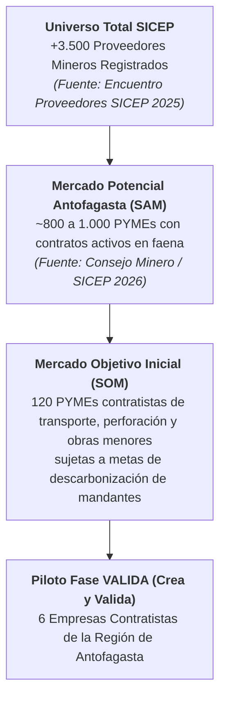

# Estrategia de Levantamiento y Defensa Técnica: Fase 2 Crea y Valida (ID 1116559)

**Proyecto:** Plataforma SaaS de Trazabilidad y Reportabilidad de Huella de Carbono para Proveedores Mineros  
**Postulante:** Grupo Verdical SpA (Empresa B - Antofagasta)  
**Objetivo de este documento:** Consolidar el plan de trabajo, argumentos técnicos de I+D (Ley 20.241), benchmarking de mercado (Zero Company, CarbonBox), fuentes oficiales de Antofagasta y modelo de negocio B2B para responder a las observaciones del Comité Corfo Antofagasta.

---

## 1. Bloque 1: Defensa de I+D (Ley 20.241) frente al Estado del Arte y Competidores

### 1.1. Análisis Crítico del Estado del Arte (Benchmarking Técnico)
Corfo observó que el uso de IA y OCR comercial disponible en el mercado no constituye I+D. Para responder con rigor científico-tecnológico, contrastamos las capacidades y limitaciones de las soluciones vigentes:

| Plataforma / Solución | Modelo Tecnológico Principal | Alcances que Cubre | Limitaciones Críticas en Faena Minera (El "Gap" Tecnológico) |
| :--- | :--- | :--- | :--- |
| **Zero Company** (Chile) | "Carbon Engine" en nube con screening corporativo rápido. | Scope 1, 2 y 3 corporativo. | • Requiere que el usuario ingrese datos consolidados o planillas estructuradas.<br>• No resuelve la extracción semántica desestructurada desde facturas y guías de terreno.<br>• Orientado al corporativo mandante, no a la operativa de la PYME en faena. |
| **CarbonBox** (Latam / Chile) | SaaS con base de 30.000 factores globales (SBTi, GHG Protocol). | Scope 1, 2 y 3; ciclo de vida. | • Su módulo de estimación se alimenta de cargas masivas de datos tabulares.<br>• Los OCR comerciales que utiliza fallan sistemáticamente ante glosas chilenas ambiguas.<br>• No genera un expediente probatorio auditable con firma criptográfica 1:1 hacia el DTE original. |
| **Document-AI Comerciales** (AWS Textract, Google Doc AI, Azure) | Modelos fundacionales de extracción de tablas y entidades (NER). | N/A (Solo extracción de texto). | • Extraen "claves-valor" genéricas (RUT, Total, IVA).<br>• Colapsan al clasificar ítems ambiguos (ej: diferenciar diésel móvil de maquinaria vs. diésel estacionario de generador en faena).<br>• Tasa de error en glosas de faena chilena superior al 35%. |
| **Nuestra Propuesta (Grupo Verdical)** | **Arquitectura Híbrida de Visión Espacial + LLM Específico de Faena + Motor Bayesiano de Reconciliación.** | Scope 1, 2 y 3 específico para faena minera. | • **Automatización radical:** Desde la factura DTE 33 o guía DTE 52 directa, sin digitación manual.<br>• **Trazabilidad Criptográfica:** Hash SHA-256 que asocia factura, factor de emisión oficial y reporte final.<br>• **Exportabilidad Multi-Norma:** Genera reportes simultáneos para GHG Protocol, ISO 14064, CMF NCG 461/NIIF S2 y portales mineros (SICEP, Achilles). |

### 1.2. La Hipótesis de I+D para la Formulación Definitiva
> *"Es factible diseñar e implementar una arquitectura algorítmica híbrida que integre modelos de visión espacial con un modelo de lenguaje de contexto cerrado adaptado a la jerga operacional minera chilena y un motor bayesiano de reconciliación semántica, logrando una precisión de extracción y homologación $\ge 92\%$ sobre documentación heterogénea y ruidosa de faena, superando el límite de precisión de los OCR/Document-AI comerciales ($\le 65\%$) y garantizando la trazabilidad matemática inmutable exigida por auditorías ISO 14064."*

### 1.3. Clasificación Rigurosa de TRL por Componente
Para subsanar la observación de Corfo, la arquitectura se divide formalmente en:
* **Módulo Base Lector (TRL 4 - Demostrado):** Pipeline probado en laboratorio con más de 200 documentos DTE.
* **Módulo de Reconciliación Probabilística y Mapeo Multiestándar (TRL 2-3 $\rightarrow$ TRL 6):** Componente de I+D experimental nuevo que modelará las relaciones entre glosas de compra, factores oficiales del SEN/HuellaChile y normativas divergentes.
* **Módulo de Detección de Anomalías e Inconsistencias (TRL 3 $\rightarrow$ TRL 6):** Modelamiento estadístico de patrones de consumo para detectar duplicidades o desvíos operacionales.
* **Plataforma Integrada (TRL 4 $\rightarrow$ TRL 7):** Integración completa validada en condiciones reales de faena con 6 contratistas mineros durante la Fase VALIDA.

---

## 2. Bloque 2: Preguntas y Pauta Técnica para Discutir con el Asesor TI (Luchito)

Lleva esta pauta a la reunión con tu asesor para cerrar los detalles de arquitectura y formulación:

1. **Protocolo Experimental de Benchmarking:**
   * *Acción:* Procesar una muestra de 50 facturas y guías mineras con Google Document AI / AWS Textract y documentar cuántas fallan en clasificar el combustible o el centro de costo.
   * *Resultado esperado:* Obtener la tasa de error real ($\gt 30\%$) para incluirla como justificación cuantitativa en el formulario.
2. **Diseño del Corpus de Entrenamiento y Testeo:**
   * *Pregunta:* "¿Cómo estructuraremos el dataset de 1.000 documentos para el ajuste del modelo? (Recomendado: 700 para entrenamiento y validación cruzada, 300 para testeo ciego final)".
3. **Métricas de Éxito de los Objetivos Específicos:**
   * *Precisión de extracción documental:* Línea base 80% $\rightarrow$ Meta final: $\ge 92\%$.
   * *Consistencia multiestándar:* Desviación $\le 1\%$ entre el inventario reportado bajo GHG Protocol versus ISO 14064-1.
   * *Integridad probatoria:* $100\%$ de los registros de emisión vinculados mediante hash SHA-256 al documento PDF fuente.
4. **Definición de Perfiles Técnicos a Contratar:**
   * *Pregunta:* "¿Qué perfiles curriculares presentaremos para el Ingeniero de Machine Learning / IA y para el Desarrollador Full-Stack Cloud en la plataforma de postulación?"

---

## 3. Bloque 3: Datos Duros de Mercado, Problema y Actores (Antofagasta)

### 3.1. Cuantificación del Mercado Objetivo y Fuentes Oficiales



* **Magnitud del Gasto Minero:** Las compras a proveedores mineros en la Región de Antofagasta proyectan más de **US\$ 11.300 millones hacia el 2035** (*Fuente: Territorio Minero / Cochilco*), concentrando el mayor flujo documental de abastecimiento del país.
* **Exigencia y Consecuencia Contractual:**
  * **Minera Centinela (AMSA):** El portal de proveedores exige adhesión a metas de sustentabilidad y trazabilidad Scope 3 para mantener convenios activos.
  * **BHP (Programa de Compra Local):** Prioriza la adjudicación y permanencia de contratistas locales que demuestren estándares verificables en gestión ESG y huella ambiental.
  * **Consecuencia:** La PYME que no reporta o entrega reportes con errores aritméticos enfrenta **descalificación en licitaciones, retención de estados de pago o pérdida de contratos marco**.

### 3.2. Mapeo Preciso de Actores

```
+----------------------------------------------------------------------------------------------------+
|  MAPEO DE ACTORES DEL ECOSISTEMA B2B                                                               |
+----------------------------------------------------------------------------------------------------+
|  1. USUARIO FINAL OPERATIVO:                                                                       |
|     * Encargado de Prevención de Riesgos / Medio Ambiente (HSEC) o Administrativo de Faena.        |
|     * Dolor: Gasta entre 30 y 50 horas/mes digitando facturas en planillas Excel complejas.       |
|                                                                                                    |
|  2. COMPRADOR / DECISOR ECONÓMICO:                                                                |
|     * Gerente General / Dueño de la PYME Contratista Minera.                                       |
|     * Motivación: Asegurar la continuidad operacional, ganar licitaciones y reducir costos de      |
|       consultoría anual ($3M a $7M CLP).                                                           |
|                                                                                                    |
|  3. MANDANTE / EVALUADOR CONTRACTUAL:                                                              |
|     * Superintendencias de Abastecimiento, Contratos y Sustentabilidad de BHP, AMSA y Codelco.    |
|     * Necesidad: Recibir datos primarios de Scope 3 auditables, libres de "greenwashing" y listos  |
|       para consolidar en sus reportes anuales NIIF S2 / CMF.                                       |
+----------------------------------------------------------------------------------------------------+
```

---

## 4. Bloque 4: Estrategia Comercial (SaaS B2B), Precios y Matriz de Riesgos

### 4.1. Análisis Comparativo de Precios (Benchmarking Comercial)
* **Consultorías Tradicionales en Chile:** \$3.500.000 a \$7.000.000 CLP por un informe anual estático en PDF (demora de 2 a 3 meses).
* **CarbonBox (Referencia Internacional):** 
  * Plan Profesional: **\$2.903 USD/año (~$2.800.000 CLP/año)**.
  * Plan Experto: **\$3.752 USD/año (~$3.600.000 CLP/año)**.
* **Zero Company (Chile):** Tarificación a medida basada en complejidad y tamaño de empresa corporativa.

### 4.2. Estructura de Precios Propuesta para Grupo Verdical (B2B SaaS)

| Nivel de Suscripción | Precio Mensual | Precio Anualizado | Capacidad / Características | Segmento Objetivo |
| :--- | :---: | :---: | :--- | :--- |
| **Plan PYME Básico** | **UF 4/mes** (~$150.000 CLP) | **~$1.800.000 CLP/año** | • Hasta 150 DTEs procesados/mes.<br>• Scope 1 y 2.<br>• Reporte estándar GHG Protocol.<br>• Acompañamiento inicial. | Contratistas pequeños (mantención menor, alimentación, servicios de soporte). |
| **Plan Faena Pro** | **UF 8/mes** (~$300.000 CLP) | **~$3.600.000 CLP/año** | • Hasta 500 DTEs procesados/mes.<br>• Scope 1, 2 y 3.<br>• Expediente digital con hash SHA-256.<br>• Exportación para SICEP, Achilles y portales mineros. | Empresas de transporte, movimiento de tierra, perforación y obras civiles. |

* **Ahorro Cuantificado para el Cliente:** **Entre 50% y 65% de ahorro económico directo** comparado con la consultoría anual externa, sumado a un ahorro de **más del 80% en horas/hombre** del personal administrativo.

### 4.3. Costos Unitarios de Operación y Márgenes del SaaS
* **Costo Cloud por Documento (AWS + Tokens Inferencia LLM):** ~$90 a $120 CLP por documento procesado y almacenado.
* **Costo Servidor/Infraestructura por PYME:** ~$20.000 a $35.000 CLP mensuales.
* **Margen Bruto Proyectado:** **$\ge 75\%$**, lo que asegura un modelo de negocio sostenible y rentable finalizado el subsidio Corfo.

### 4.4. Estrategia de Apropiabilidad Tecnológica (Sin Patentes)
* **Secreto Industrial del Modelo de Datos:** Protección contractual y cifrado del repositorio de fine-tuning y pesos de inferencia.
* **Moat (Foso Defensivo) del Dataset:** El conjunto de entrenamiento de facturas mineras chilenas y glosas de faena constituye un activo intangible propietario de Grupo Verdical difícil de emular por plataformas extranjeras.
* **Términos de Servicio y Licenciamiento:** Prohibición contractual de ingeniería inversa y retención de propiedad sobre los algoritmos de homologación.

### 4.5. Matriz de Riesgos y Mitigación

| Riesgo Identificado | Severidad | Probabilidad | Estrategia de Mitigación Operativa |
| :--- | :---: | :---: | :--- |
| **Variación de Factores Oficiales (Regulatorio)** | Media | Media | Arquitectura desacoplada: los factores de emisión de HuellaChile y SEN se gestionan en tablas maestras versionadas en base de datos sin alterar el código fuente. |
| **Rechazo de Reportes por Mandantes Mineras** | Alta | Baja | Validación cruzada de la estructura de reporte con auditores externos acreditados en ISO 14064 durante la Fase CREA. |
| **Heterogeneidad Documental Extrema en Terreno** | Alta | Media | Implementación de una interfaz *Human-in-the-Loop* de revisión rápida, donde la IA pre-clasifica y el operador valida en un solo clic las excepciones. |
| **Sobrecosto de Inferencia Cloud (APIs)** | Baja | Baja | Optimización de tokens mediante pre-procesamiento local (PyMuPDF) y migración a modelos de pesos abiertos (*open-weights*) auto-hospedados si el volumen escala. |
